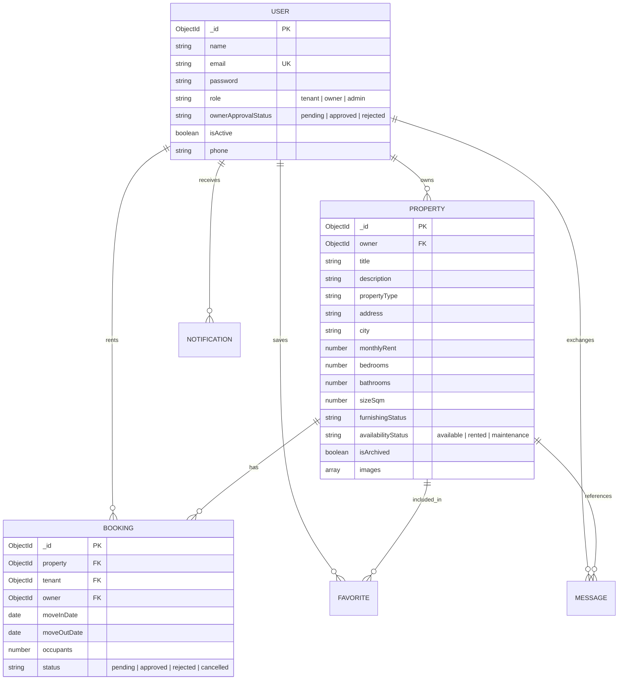

# 🏡 HouseHunt — Complete MERN Stack House Rental Web Application

> **SkillWallet Full-Stack Development Capstone Project**  
> A modern, production-ready house rental marketplace connecting prospective tenants with property owners, featuring role-based access control, rental booking management, in-app messaging, and administrative moderation.

---

## 📋 Table of Contents

- [Overview](#-overview)
- [Key Features by Role](#-key-features-by-role)
  - [Public / Guest Visitors](#1-public--guest-visitors)
  - [Tenants / Renters](#2-tenants--renters)
  - [Property Owners / Landlords](#3-property-owners--landlords)
  - [Platform Administrators](#4-platform-administrators)
- [Technology Stack](#-technology-stack)
- [System Architecture & Database Design](#-system-architecture--database-design)
- [Project Directory Structure](#-project-directory-structure)
- [Getting Started](#-getting-started)
  - [Prerequisites](#prerequisites)
  - [Installation](#installation)
  - [Environment Variables](#environment-variables)
  - [Database Seeding](#database-seeding)
  - [Running the Application](#running-the-application)
- [Pre-configured Demo Accounts](#-pre-configured-demo-accounts)
- [API Reference](#-api-reference)
- [Testing & Quality Assurance](#-testing--quality-assurance)

---

## 🌟 Overview

**HouseHunt** is a full-featured real estate rental marketplace tailored for Indonesian urban centers (Jakarta, Bandung, Surabaya, Yogyakarta, Bali, etc.). The application facilitates the entire tenancy journey:

1. **Discovery**: Tenants explore verified rental listings with interactive multi-criteria filters, image galleries, and pricing in Indonesian Rupiah (IDR).
2. **Booking Lifecycle**: Tenants request rental dates; property owners review applications and approve/reject bookings. Approving a booking automatically updates unit availability and notifies competing applicants.
3. **Direct Inquiries**: Built-in real-time messaging allows tenants to communicate directly with landlords regarding viewings and lease inquiries.
4. **Governance**: Administrators supervise user accounts, enforce owner identity verification, moderate property listings, and audit platform transactions.

---

## 🎯 Key Features by Role

### 1. Public / Guest Visitors
- **Hero Landing Experience**: Highlights featured and recently listed properties with clean photography.
- **Advanced Search & Discovery**:
  - Filter by City, Property Type (*Apartment, House, Studio, Townhouse, Villa, Kost*), Rent Price range, Bedrooms, Bathrooms, Furnishing status, and Amenities.
  - Keyword search across property titles, addresses, and descriptions.
  - Sorting options (*Newest, Price: Low to High, Price: High to Low*).
- **Property Detail Page**:
  - Multi-image responsive photo gallery with thumbnail preview.
  - Comprehensive property specs (size in m², bedrooms, bathrooms, furnishing, amenities checklist).
  - Public landlord contact information card and "Similar Properties" recommendations.

### 2. Tenants / Renters
- **Authentication & Security**: Email/password registration and login with secure HttpOnly cookies & JWT tokens.
- **Tenant Dashboard**: Quick metrics on active bookings, saved listings, and recent rental requests.
- **Rental Request Workflow**:
  - Interactive booking modal specifying preferred move-in and move-out dates, occupant count, and personal note to owner.
  - Duplicate booking prevention and owner self-booking restrictions.
  - Ability to cancel pending requests before landlord decision.
- **Favorites / Saved Properties**: 1-click wishlist toggle persisted in MongoDB.
- **Tenant Messaging**: Real-time conversation thread with landlords directly linked to specific properties.
- **Profile Management**: Update name, phone number, and change account password.

### 3. Property Owners / Landlords
- **Vetted Account Approval**: New owner accounts start in `pending` state and require administrator approval before publishing listings.
- **Owner Dashboard**: Real-time metrics tracking total listings, active rentals, occupied properties, and pending booking inquiries with visual distribution charts.
- **Complete Property CRUD**:
  - **Create**: Add properties with title, description, category, address, city, monthly rent (IDR), bedrooms, bathrooms, size (m²), furnishing status, and multiple photo URLs.
  - **Read**: Comprehensive list of owned properties with active booking counters.
  - **Update**: Edit details, upload additional photos, or change availability (`available`, `rented`, `maintenance`).
  - **Archive**: Soft-delete properties to hide from public search while preserving historical bookings.
- **Booking Management**:
  - Review incoming rental applications with tenant details and requested dates.
  - **Smart Approval Engine**: Approving a booking marks the property as `rented` and automatically rejects other overlapping pending requests, dispatching instant notifications to all parties.
- **Owner Inbox**: Chat with interested tenants regarding property viewings.

### 4. Platform Administrators
- **Executive Dashboard**: System-wide statistics including total users, total listings, active bookings, and role distributions.
- **Owner Verification Portal**: Inspect owner applications, approve verified hosts, or reject non-compliant applicants with reason logging.
- **User Management**: View all platform users, filter by role/status, search by keyword, and activate/suspend accounts.
- **Listing Moderation**: Review all platform properties across all owners with the ability to archive or restore listings.
- **Booking Audit Trail**: Read-only oversight of all rental transactions and status histories across the platform.

---

## 🛠 Technology Stack

### Frontend (`client/`)
| Technology | Description |
| :--- | :--- |
| **React 18** | Declarative component-based UI library |
| **Vite** | Next-generation frontend tooling and fast HMR bundler |
| **React Router v6** | Client-side routing, protected routes, and nested layouts |
| **Tailwind CSS** | Utility-first CSS framework with custom brand teal/navy design system |
| **Axios** | HTTP client configured with credentials and response interceptors |
| **React Hook Form + Zod** | Form state management paired with runtime schema validation |
| **Lucide React** | Consistent, modern icon set |
| **Recharts** | Interactive charts for owner and administrator dashboards |
| **React Hot Toast** | Accessible, toast notifications |

### Backend (`server/`)
| Technology | Description |
| :--- | :--- |
| **Node.js (LTS)** | JavaScript runtime environment |
| **Express.js** | Modular RESTful API framework |
| **MongoDB & Mongoose ODM** | Document database with schemas, compound indexes, and validations |
| **JSON Web Tokens (JWT)** | Stateless authentication with HttpOnly cookie and Bearer header fallback |
| **bcryptjs** | Salted password hashing (12 salt rounds) |
| **Zod** | Server-side request validation middleware for bodies and queries |
| **Helmet & CORS** | Security headers and cross-origin resource sharing protection |
| **Express Rate Limit** | Brute-force and DoS protection on auth and API endpoints |
| **Multer** | Multipart form-data handling for file uploads |
| **MongoMemoryServer** | Zero-config embedded MongoDB fallback for seamless local development |

---

## 🗄 System Architecture & Database Design

The data layer is modeled in MongoDB using Mongoose with proper relationships and indexing:



---

## 📂 Project Directory Structure

```text
househunt/
├── client/                     # Frontend React + Vite application
│   ├── src/
│   │   ├── __tests__/          # Client-side component & util tests
│   │   ├── components/
│   │   │   ├── common/         # Navbar, Footer, Modal, Badge, Pagination, etc.
│   │   │   ├── layout/         # AppLayout, DashboardLayout, ProtectedRoute
│   │   │   ├── messages/       # In-app chat components
│   │   │   ├── property/       # PropertyCard, PropertyFilters, ImageGallery, BookingModal
│   │   │   └── ui/             # Reusable UI primitives (Button, Input, Select, StatCard)
│   │   ├── context/            # AuthContext, NotificationContext
│   │   ├── hooks/              # useAuth, useNotifications custom hooks
│   │   ├── pages/
│   │   │   ├── admin/          # Admin Dashboard, User Management, Approvals, Properties, Bookings
│   │   │   ├── auth/           # Login & Registration pages
│   │   │   ├── common/         # User Profile page
│   │   │   ├── owner/          # Owner Dashboard, CRUD property forms, Bookings
│   │   │   ├── public/         # Landing, Browse Properties, Property Details, 404
│   │   │   ├── shared/         # Messaging portal
│   │   │   └── tenant/         # Tenant Dashboard, My Bookings, Saved Properties
│   │   ├── services/           # Axios API service modules
│   │   ├── utils/              # IDR currency & date formatters, constants
│   │   ├── App.jsx             # React Router route registry
│   │   └── main.jsx            # React root entry point
│   ├── tailwind.config.js
│   └── vite.config.js
│
├── server/                     # Backend Express.js API
│   ├── config/                 # Database connection with embedded fallback
│   ├── controllers/            # Route controllers (Auth, Property, Booking, Admin, Message, etc.)
│   ├── middleware/             # Auth, role authorization, Zod validation, error handling
│   ├── models/                 # Mongoose schemas (User, Property, Booking, Favorite, Message, etc.)
│   ├── routes/                 # Express router declarations
│   ├── scripts/                # Database seed runner and Mongo helper scripts
│   ├── services/               # Notification and messaging helper services
│   ├── tests/                  # Backend API test suites (Vitest + Supertest)
│   ├── utils/                  # JWT token management, standard API response wrappers
│   ├── validators/             # Zod validation schemas
│   ├── app.js                  # Express application setup
│   └── server.js               # HTTP server entry point
│
├── package.json                # Monorepo workspace configuration
└── README.md
```

---

## 🚀 Getting Started

### Prerequisites
- **Node.js**: v18.0.0 or higher
- **npm**: v9.0.0 or higher
- *(Optional)* Local MongoDB instance or MongoDB Atlas connection string. (An embedded in-memory MongoDB is built-in and starts automatically if no database is found).

### Installation

Clone the repository and install all dependencies:

```bash
git clone https://github.com/your-username/househunt.git
cd househunt

# Install root, server, and client dependencies in one command
npm run install:all
```

### Environment Variables

The project includes pre-configured `.env.example` templates. 

#### 1. Server Environment (`server/.env`):
```env
PORT=8000
NODE_ENV=development
MONGO_URI=mongodb://127.0.0.1:27017/househunt
JWT_SECRET=househunt_super_secret_jwt_key_2026_skillwallet
JWT_EXPIRES_IN=7d
CLIENT_URL=http://localhost:5173
```

#### 2. Client Environment (`client/.env`):
```env
VITE_API_URL=http://localhost:8000/api
```

### Database Seeding

Populate the database with realistic sample Indonesian properties, demo users, bookings, and messages:

```bash
npm run seed
```

### Running the Application

To start both the Express backend API and the Vite frontend concurrently in development mode:

```bash
npm run dev
```

The application will be accessible at:
- **Frontend**: [http://localhost:5173](http://localhost:5173)
- **Backend API**: [http://localhost:8000/api](http://localhost:8000/api)
- **API Health Check**: [http://localhost:8000/api/health](http://localhost:8000/api/health)

---

## 🔑 Pre-configured Demo Accounts

All seeded demo accounts use the standard password: `Password123!`

| Role | Email | Password | Permissions & Description |
| :--- | :--- | :--- | :--- |
| **Administrator** | `admin@househunt.id` | `Password123!` | Full admin access: verify owners, moderate listings, manage all users |
| **Approved Owner** | `budi.santoso@househunt.id` | `Password123!` | Verified landlord: can create, edit, archive properties & approve bookings |
| **Approved Owner** | `siti.rahma@househunt.id` | `Password123!` | Verified landlord: manages properties in Bandung & Bali |
| **Pending Owner** | `dewi.lestari@househunt.id` | `Password123!` | Unverified landlord: cannot post properties until approved by Admin |
| **Tenant** | `andi.wijaya@househunt.id` | `Password123!` | Standard renter: can browse, favorite, message, and submit booking requests |
| **Tenant** | `maya.putri@househunt.id` | `Password123!` | Standard renter: active rental applicant in Jakarta |

*(Note: The login page includes a 1-click credential selector for quick evaluation).*

---

## 📡 API Reference

All endpoints are prefixed with `/api`.

### Authentication & Users
| Method | Endpoint | Access | Description |
| :--- | :--- | :--- | :--- |
| `POST` | `/auth/register` | Public | Register new Tenant or Owner |
| `POST` | `/auth/login` | Public | Login and receive JWT cookie/token |
| `POST` | `/auth/logout` | Authenticated | Invalidate session cookie |
| `GET` | `/auth/me` | Authenticated | Retrieve authenticated user profile |
| `PUT` | `/auth/password` | Authenticated | Change user password |
| `GET` | `/users/profile` | Authenticated | Get detailed profile info |
| `PATCH` | `/users/profile` | Authenticated | Update personal profile details |

### Properties
| Method | Endpoint | Access | Description |
| :--- | :--- | :--- | :--- |
| `GET` | `/properties` | Public | Search and filter listings with pagination |
| `GET` | `/properties/:id` | Public | Get single property listing details |
| `POST` | `/properties` | Approved Owner | Create new property listing |
| `PUT` | `/properties/:id` | Owner / Admin | Update existing property listing |
| `PATCH` | `/properties/:id/archive`| Owner / Admin | Archive/restore property listing |
| `GET` | `/properties/my/listings` | Owner | Retrieve current owner's property catalog |
| `POST` | `/properties/upload` | Owner | Upload property images |

### Bookings
| Method | Endpoint | Access | Description |
| :--- | :--- | :--- | :--- |
| `POST` | `/bookings` | Tenant | Submit a new rental booking request |
| `GET` | `/bookings/my` | Tenant | Get tenant's personal booking history |
| `GET` | `/bookings/owner` | Owner | Get all booking requests for owner's properties |
| `PATCH` | `/bookings/:id/status` | Owner | Approve or reject booking request |
| `PATCH` | `/bookings/:id/cancel` | Tenant | Cancel personal pending booking request |

### In-App Messaging & Notifications
| Method | Endpoint | Access | Description |
| :--- | :--- | :--- | :--- |
| `GET` | `/messages/conversations` | Authenticated | List all active conversation threads |
| `GET` | `/messages/:propertyId/:otherUserId` | Authenticated | Retrieve conversation history |
| `POST` | `/messages` | Authenticated | Send direct message to tenant or owner |
| `GET` | `/notifications` | Authenticated | Get user notifications with unread count |
| `PATCH` | `/notifications/:id/read` | Authenticated | Mark individual notification as read |
| `PATCH` | `/notifications/read-all`| Authenticated | Mark all notifications as read |

### Administration
| Method | Endpoint | Access | Description |
| :--- | :--- | :--- | :--- |
| `GET` | `/admin/dashboard` | Admin | Aggregate platform metrics and charts |
| `GET` | `/admin/users` | Admin | Paginated list of users with search/filter |
| `PATCH` | `/admin/users/:id/approval`| Admin | Approve or reject owner registration |
| `PATCH` | `/admin/users/:id/status` | Admin | Activate or suspend user account |
| `GET` | `/admin/properties` | Admin | View all properties with archive status |
| `GET` | `/admin/bookings` | Admin | Global audit view of all platform bookings |

---

## 🧪 Testing & Quality Assurance

The codebase includes automated test suites covering backend API routes and frontend components:

```bash
# Run both backend and frontend test suites
npm test

# Run backend tests only (Vitest + Supertest + In-Memory MongoDB)
npm run test:server

# Run frontend tests only (Vitest + React Testing Library)
npm run test:client

# Run production build verification
npm run build
```

---

## 📄 License

This project was developed as a Capstone Project for the **SkillWallet** Full-Stack Development Certification program. Distributed under the ISC License.
